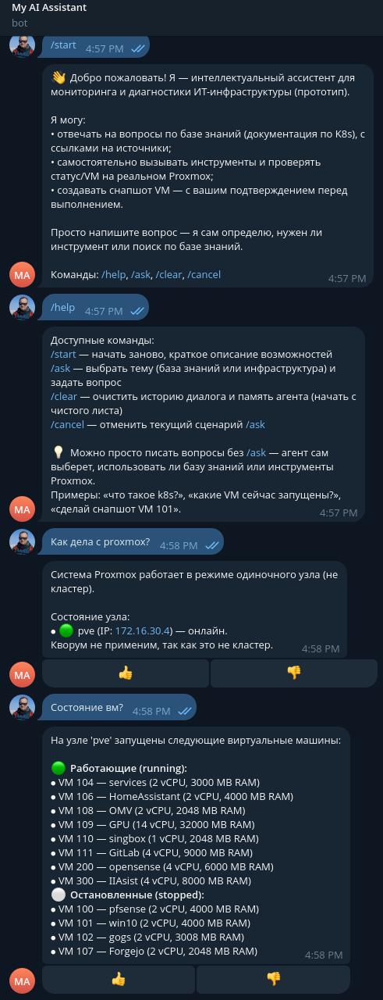
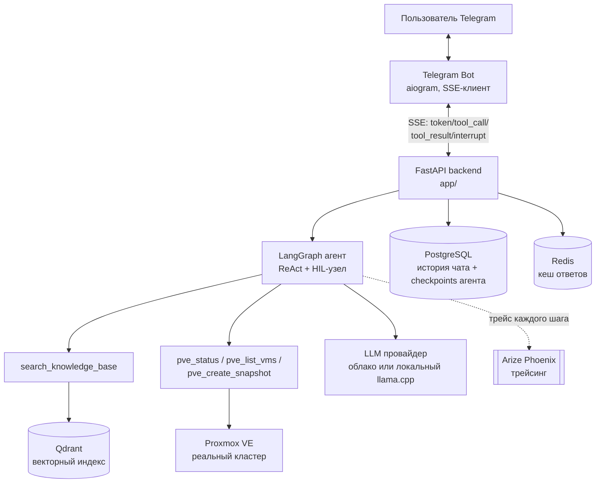

# Интеллектуальный ассистент мониторинга и диагностики ИТ-инфраструктуры

Дипломный проект курса **Netology AI-Dev**. Прототип ассистента для ИТ-администратора:
Telegram-бот поверх агента с инструментами (LangGraph) и RAG по базе знаний (Qdrant +
LlamaIndex). Автор: Dmitrii Osipov.

> **Статус**: рабочий прототип. Из трёх заявленных адаптеров инфраструктуры
> (Proxmox / Kubernetes / Linux-хосты) в этой версии реализован и подключён к агенту
> только **Proxmox VE**. Kubernetes и Linux — см. раздел [«Куда развивать»](#куда-развивать-варианты-дальнейшего-развития).

> **Развёртывание**: прототип работает на собственном домашнем DIY-сервере автора
> (не облако, не арендованный VPS) — виртуальная машина в личном кластере Proxmox VE.
> Подробности стенда и почему выбрана именно такая конфигурация — раздел
> [«Инфраструктура стенда»](#инфраструктура-стенда).

---

## Содержание

- [Идея и обоснование](#идея-и-обоснование)
- [Что может ассистент сейчас](#что-может-ассистент-сейчас)
- [Сценарии для проверяющего](#сценарии-для-проверяющего)
- [Архитектура](#архитектура)
- [Инструменты агента](#инструменты-агента)
- [База знаний (RAG)](#база-знаний-rag)
- [Инфраструктура стенда](#инфраструктура-стенда)
- [AI-каталог моделей и эндпоинтов](#ai-каталог-моделей-и-эндпоинтов)
- [Запуск](#запуск)
- [Переменные окружения](#переменные-окружения)
- [Тесты и оценка качества](#тесты-и-оценка-качества)
- [Структура репозитория](#структура-репозитория)
- [Ограничения прототипа](#ограничения-прототипа)
- [Куда развивать (варианты дальнейшего развития)](#куда-развивать-варианты-дальнейшего-развития)
- [Как делался проект (честно)](#как-делался-проект-честно)

---

## Идея и обоснование

**Тема диплома**: «Разработка и исследование интеллектуального ассистента мониторинга
и диагностики ИТ-инфраструктуры».

Ассистент должен дать администратору on-premise инфраструктуры единый
естественно-языковой интерфейс: вопрос по документации/регламентам (RAG) и вопрос о
текущем состоянии реальной системы (инструменты агента) обрабатываются одним ботом,
без переключения между grep по wiki, SSH и консолью гипервизора.

- **Актуальность.** Администрирование on-premise инфраструктуры требует постоянного
  ручного поиска по логам, метрикам и документации нескольких систем. Алерты и дашборды
  отвечают на простые пороговые вопросы, но не на контекстные («почему так», «что сейчас
  происходит на этом узле»).
- **Безопасность по умолчанию.** Ассистент — информационный, не управляющий. Любое
  действие, меняющее состояние инфраструктуры, проходит через подтверждение человеком
  (Human-in-the-Loop) — это намеренное архитектурное решение, а не недостаток.
- **Практическая польза.** Автор лично администрирует кластер Proxmox, на котором
  развёрнут прототип — инструменты интегрированы с реальной инфраструктурой, а не
  с синтетическим стендом.
- **Соответствие курсу.** Проект закрывает все блоки курса: FastAPI-backend,
  интеграция с внешним API (Proxmox), LLM (облако + локальная модель), RAG с
  векторным поиском, агент с инструментами и графом состояний (LangGraph),
  Telegram-интерфейс, трейсинг, персистентность диалога.

## Что может ассистент сейчас

| Возможность | Как реализовано |
|---|---|
| Ответ на вопрос по базе знаний (документация Kubernetes, ~114 файлов) | RAG-инструмент `search_knowledge_base` поверх Qdrant + LlamaIndex, источники возвращаются вместе с ответом |
| Статус узла Proxmox | Инструмент `pve_status` (read-only) |
| Список виртуальных машин и контейнеров с их состоянием | Инструмент `pve_list_vms` (read-only) |
| Создание снапшота тестовой VM | Инструмент `pve_create_snapshot` — **опасное действие**, выполняется только после подтверждения пользователем (кнопки в Telegram) |
| Диалог переживает перезапуск сервиса | Состояние агента и история чата — в PostgreSQL (LangGraph checkpointer + ChatRepository) |
| Загрузка файлов в диалог | Картинки, аудио (голосовые → Whisper), PDF/DOCX как вложения к сообщению |
| Оценка ответа | Кнопки 👍/👎 под каждым ответом ассистента |

Один и тот же LLM-агент сам решает, нужен ли для ответа RAG-поиск, Proxmox-инструмент
или обычный ответ без инструментов — пользователь не выбирает режим явно.

## Сценарии для проверяющего

Боту можно задать (адрес/ссылку на развёрнутого бота см. в сопроводительном письме к
сдаче работы):



**Вопросы по базе знаний (RAG, ответ с источниками):**
1. «Что такое Pod в Kubernetes и чем он отличается от контейнера?»
2. «Как устроена сетевая модель Kubernetes (CNI)?»
3. «Какие есть механизмы RBAC для ограничения доступа в кластере?»

**Инструменты агента (реальный вызов к Proxmox-кластеру):**
4. «Какой сейчас статус узла Proxmox?» → вызов `pve_status`
5. «Покажи список виртуальных машин и их состояние» → вызов `pve_list_vms`

**Опасное действие с подтверждением (HIL):**
6. «Сделай снапшот тестовой VM» → агент готовит действие, бот присылает кнопки
   «✅ Подтвердить» / «❌ Отклонить»; снапшот реально создаётся в Proxmox только
   после нажатия «Подтвердить». Видео с полным сценарием (вызов инструмента → `interrupt` →
   подтверждение в Telegram → снапшот реально появился в Proxmox):
   [`docs/media/vm-snapshot.webm`](docs/media/vm-snapshot.webm).

> **Ограницение для безопасности стенда.** Бот работает на реальном домашнем Proxmox-кластере
> автора. Инструмент `pve_create_snapshot` жёстко ограничен сервером на уровне
> `node`/`vmid` (только заранее заданная демонстрационная VM) и рата-лимитом на
> количество снапшотов в сутки на один чат — детали в
> [«Инструменты агента»](#инструменты-агента). Даже многократные повторные подтверждения
> не смогут создать снапшоты на других VM или заспамить хранилище снапшотов.

**Граница возможностей:**
7. Вопрос вне базы знаний и вне инструментов (например, «какая погода в Москве») —
   ассистент честно отвечает, что не может помощь, вместо выдумывания ответа.

## Архитектура



Запрос проходит так:

1. Пользователь пишет в Telegram-бота → бот создаёт/находит чат на backend
   (`POST /chats`) и отправляет сообщение (`POST /chats/{id}/messages`, SSE).
2. Backend прогоняет сообщение через персистентный LangGraph-граф
   (`app/services/agent_persistent.py`): модель решает, нужен ли инструмент.
3. Безопасные инструменты (`search_knowledge_base`, `pve_status`, `pve_list_vms`)
   исполняются сразу, их результат возвращается модели для финального ответа.
4. Опасный инструмент (`pve_create_snapshot`) не исполняется напрямую — граф
   останавливается на `interrupt()` и ждёт подтверждения. Бот показывает кнопки,
   решение пользователя уходит на `POST /chats/{id}/messages/resume`, граф
   продолжает выполнение с того же места (состояние хранится в PostgreSQL).
5. Токены ответа, вызовы инструментов и их результаты стримятся в Telegram через SSE
   по мере готовности.

Подробнее: [`docs/architecture.md`](docs/architecture.md), схема графа агента —
[`docs/agent-graph-custom.md`](docs/agent-graph-custom.md).

## Инструменты агента

Реализованы в `app/agents/tools_proxmox.py` и `app/agents/tools.py`, подключаются к
графу в `app/main.py::lifespan()`.

| Инструмент | Тип | Что делает |
|---|---|---|
| `search_knowledge_base` | read-only | Семантический поиск по базе знаний (RAG), возвращает ответ + источники |
| `pve_status` | read-only | Статус узла(ов) Proxmox VE (single-node datacenter в текущем стенде) |
| `pve_list_vms` | read-only | Список QEMU VM и LXC-контейнеров на узле: статус, vCPU, RAM |
| `pve_create_snapshot` | **опасное, с подтверждением** | Создаёт снапшот тестовой VM. Само тело инструмента не делает вызов к API — оно лишь формирует намерение; реальный вызов Proxmox происходит в отдельном узле графа (`confirm_and_create_snapshot`) только после `Command(resume=...)` с положительным решением человека |

Human-in-the-Loop реализован через `langgraph.types.interrupt()`: граф
приостанавливается перед реальным сайд-эффектом, состояние (`draft`, tool_call_id)
сохраняется в PostgreSQL-чекпоинтере, выполнение продолжается тем же треком после
того, как пользователь нажал кнопку в Telegram.

## База знаний (RAG)

- Корпус: документация Kubernetes, 114 markdown-файлов (`data/kb/kubernetes/`) —
  архитектура, FAQ, безопасность, сети, workloads, runbooks. Подробности —
  [`docs/data_inventory.md`](docs/data_inventory.md).
- Векторное хранилище — Qdrant, эмбеддинги — настраиваемая модель (по умолчанию
  локальная через llama.cpp, см. `EMBEDDING_*` переменные).
- Чанкинг и ретривер — LlamaIndex, параметры подбирались экспериментально
  (см. [`docs/chunking_report.md`](docs/chunking_report.md)).
- Качество поиска оценивалось на golden-датасете (`eval/golden_dataset.json`),
  пороги — `eval/thresholds.yaml`, отчёт — [`docs/agent-react-report.md`](docs/agent-react-report.md).

> Почему база знаний про Kubernetes, а инструменты агента — про Proxmox? Корпус
> документов собирался для RAG-блока курса независимо от того, какой конкретно
> гипервизор/оркестратор станет первым подключённым инструментом агента. Для прототипа
> это не противоречие: RAG и инструменты агента — независимые слои, граф сам выбирает,
> какой из них использовать под конкретный вопрос.

## Инфраструктура стенда

Весь стенд — собственный домашний DIY-кластер на Proxmox VE, без аренды облачных
ресурсов. Это осознанный выбор: автор администрирует реальную инфраструктуру, и
прототип тестируется и демонстрируется на том же стенде, куда он в итоге должен приносить
реальную пользу (см. [«Идея и обоснование»](#идея-и-обоснование) — «практическая польза»).

### VM для сервиса (app + bot + postgres + redis + qdrant + phoenix)

| Параметр | Значение | Почему такое |
|---|---|---|
| vCPU | 4 ядра | FastAPI + LangGraph + Qdrant + Postgres одновременно не требуют больше — нагрузка низкая, задержки даёт внешний LLM-запрос (сетевой I/O), не CPU |
| RAM | 8 GB | Qdrant + Postgres + 2 Python-процесса (app, bot) + Phoenix — на корпусе в ~114 файлов этого достаточно с заделом |
| Диск | 30 GB SSD | Образы Docker + векторный индекс Qdrant + логи + история чата в Postgres |
| Сеть | бридж к VM-сети proxmox, доступность до GPU-сервера и в Telegram API | агент дергает запросы к `llama.cpp` на отдельный хост с GPU, боту нужен outbound к `api.telegram.org` |
| ОС | Debian 13 | Docker + docker compose, никаких специальных требований к ядру |

Команды развёртывания на свежей VM (Debian 13, доступ выдан сети):

```bash
# 1. системные обновления + Docker
sudo apt update && sudo apt upgrade -y
curl -fsSL https://get.docker.com | sudo sh
sudo usermod -aG docker $USER
newgrp docker

# 2. На хосте разработки, чтобы не собирать images на слабой виртуалке, просто перенесем их 
docker save $(docker compose config --images) | gzip > /home/odv/diploma_all_images.tar.gz
scp /home/odv/diploma_all_images.tar.gz root@iiasist:/tmp/
docker load < /tmp/diploma_all_images.tar.gz
# Отдельно скопировать тома из /var/lib/docker/volumes
- qdrant & postresql

# 3. конфигурация
cp .env.example .env
nano .env   # вписать BOT_TOKEN, PVE_*, URL внешнего LLM-сервера и т.д.

# 4. старт стека
 docker compose up -d --build

# 5. миграции и проверка
 docker compose exec app alembic upgrade head
 curl http://localhost:8000/ready
```

База знаний индексируется автоматически при старте (`lifespan` в `app/main.py`), если коллекция
в Qdrant пустая. При обновлении только кода без новой VM достаточно `docker compose build app
bot && docker compose up -d app bot` — пересобирать VM не нужно.

### GPU-сервер для LLM (внешний по отношению к сервисной VM)

Инференс модели вынесен на отдельный физический хост с GPU, а не в VM сервиса — это
отдельный осознанный инфраструктурный слой:

- **GPU**: NVIDIA Tesla V100 16 GB. Выбор осознан:
  - *из чего выбирали*: сравнивались варианты облачного API (плата за каждый токен,
    зависимость от стороннего сервиса), современные консьюмерские GPU (RTX 3090/4090 —
    дороже, больше приобретение, нужен более мощный и дорогой блок питания/охлаждения в
    бытовом формате) и б/у enterprise-ускорители (Tesla/A100 на вторичном рынке).
  - *почему выбрали итого*: у автора уже есть серверная платформа с системой жидкостного охлаждения (СЖО)
    (серверный блок питания и охлаждение спроектированы изначально на несколько GPU) — это
    сделало экономически выгодным взять устаревшую, но дешёвую на вторичном рынке карту, а не
    арендовать вычисления или покупать современнее железо. Ещё один вывод из курса: собственная
    GPU даёт полный контроль над латентностью, контекстом и приватностью данных, без зависимости от
    внешнего API и без повторяющейся платы за токены.
  - *ограничения*: 16 GB VRAM — мало для современных моделей без квантования, архитектура
    Volta без аппаратной поддержки современных форматов (FP8), ниже скорость памяти по
    сравнению с современными картами. Но с 4–8-битным квантованием (GGUF Q4–Q8) её
    вполне достаточно, чтобы тянуть модель класса **Qwen3.5-9B** с большим контекстом —
    для задач ассистента с RAG и инструментами этого хватает.
- **Inference-сервер**: `llama.cpp` (`llama-server`) в режиме OpenAI-совместимого
  HTTP-сервера. На одной и той же GPU настроено **проксирование и переключение
  между несколькими моделями** под одним эндпоинтом: сама LLM (`Qwen3.5-9B`, Q5_K_M),
  несколько вариантов embedding-моделей (`Qwen3-Embedding-0.6B/4B`, `bge-m3`) и
  reranker (`bge-reranker-v2-m3`) — сервисы запрашивают нужную модель по имени, `llama.cpp`
  переключает веса в VRAM без остановки сервиса. Эта связка (один GPU → один
  проксирующий inference-сервер → несколько логических моделей) легла в основу работающего
  стенда диплома — без неё пришлось бы держать отдельный процесс на каждую модель и вручную
  переключать эндпоинты в `.env`.
- **Связь с сервисной VM**: backend и RAG-слой ходят к `llama.cpp` по внутренней
  сети (OpenAI-совместимый HTTP), адрес задаётся в `app/core/ai/ai_catalog.yaml` и
  `.env` (`LLM_LLAMACPP_*`). Живой вывод из отладки стенда: кастомная сборка `llama.cpp`
  нестандартно ведёт себя с Jinja chat-темплейтом thinking-режима у Qwen3.5 —
  отключение рассуждений работает только через корректный параметр SDK-клиента
  `extra_body={"chat_template_kwargs": {"enable_thinking": false}}`, а не теми способами, которые
  ожидались снаружи — это типичный кейс рассогласования самостоятельно хостимого LLM-стека.

## AI-каталог моделей и эндпоинтов

Проект не зашивает URL/модели напрямую в коде сервисов — вместо этого есть
отдельный модуль `app/core/ai/` — каталог «AI-инфраструктуры»:

- **AI Model** — логическая модель (`qwen3.5-9b`, `qwen3-embedding-4b`, `bge-reranker-v2-m3`, и т.д.) —
  не содержит URL или ключей, только назначение (`llm` / `embedding` / `reranker`) и свойства.
- **Endpoint** — способ доступа (`llama.cpp` на GPU-сервере автора, облачный `vselLM` и т.д.) —
  URL, тип API, источник секрета.
- Одна логическая модель может быть доступна через несколько endpoint'ов — сервисы забирают
  готовый `ModelClientConfig` и не знают, где физически работает модель.

Был добавлен по ходу проекта как удобная абстракция над растущим набором моделей/эндпоинтов
(локальный `llama.cpp`, облачный API) — не входит в обязательные требования DR.md, но
упрощает добавление новых моделей/провайдеров без изменения кода сервисов. Подробнее —
[`app/core/ai/README.md`](app/core/ai/README.md).

## Запуск

Требуется Docker и Docker Compose. Полный стек поднимается одной командой.

```bash
cp .env.example .env
# отредактировать .env — вписать реальные значения (см. таблицу переменных ниже)
docker compose up -d --build
```

Сервисы:

| Сервис | Порт | Назначение |
|---|---|---|
| `app` | 8000 | FastAPI backend (чат, RAG, агент) |
| `bot` | 8080 | Telegram-бот (long polling + внутренний webhook для алертов) |
| `postgres` | 5432 | История чатов + checkpoints агента |
| `redis` | 6379 | Кеш ответов LLM |
| `qdrant` | 6333/6334 | Векторный индекс базы знаний |
| `phoenix` | 6006/4317 | Трейсинг (Arize Phoenix UI) |

Проверка, что backend поднялся:

```bash
curl http://localhost:8000/health
curl http://localhost:8000/ready
```

Применение миграций БД (история чата, checkpoint-таблицы ведутся отдельно):

```bash
docker compose exec app alembic upgrade head
```

Наполнение базы знаний (если используется `docker compose` с нуля — Qdrant пустой,
индексация запускается автоматически в `lifespan`, но корпус можно пересобрать вручную):

```bash
docker compose exec app python scripts/ingest.py   # см. scripts/ для деталей
```

## Переменные окружения

Полный шаблон — [`.env.example`](.env.example). Переменные, помеченные там как
`# УСТАРЕЛО`, относятся к экспериментам ранних блоков курса и не влияют на работу
текущего прототипа — оставлены закомментированными для истории, но не нужны для
запуска.

### Обязательные для запуска

| Переменная | Назначение |
|---|---|
| `LLM_API_KEY` / `LLM_URL` / `LLM_DEFAULT_MODEL` | Основной LLM-провайдер (чат, транскрипция голоса, модерация) |
| `LLM_MODEL` / `LLM_ENDPOINT` | Модель и эндпоинт из `app/core/ai/ai_catalog.yaml` для LangGraph-агента (чат + инструменты RAG/Proxmox) |
| `RAG_LLM_MODEL` / `RAG_LLM_ENDPOINT` | Модель и эндпоинт для прямого RAG-ответа без агента (может совпадать с парой выше) |
| `LLM_VSELLM_API_KEY` или `LLM_LLAMACPP_*` | Ключ конкретного эндпоинта из каталога моделей — нужен тот, на который ссылается `RAG_LLM_ENDPOINT` |
| `DATABASE_URL` | PostgreSQL: история чата + checkpoints агента |
| `QDRANT_URL` / `QDRANT_API_KEY` | Векторное хранилище базы знаний |
| `EMBEDDING_MODEL` / `EMBEDDING_ENDPOINT` / `EMBEDDING_DIM` | Модель эмбеддингов для индексации и поиска |
| `BOT_TOKEN` | Токен Telegram-бота (@BotFather) |
| `INTERNAL_TOKEN` | Общий секрет для внутреннего канала backend → bot (алерты) |
| `PVE_HOST` / `PVE_USER` / `PVE_TOKEN_NAME` / `PVE_TOKEN_VALUE` | Доступ к Proxmox VE по API-токену (Datacenter → Permissions → API Tokens) |
| `PVE_DEFAULT_NODE` / `PVE_DEFAULT_VMID` | Узел/VM для демонстрационного безопасного действия (снапшот) |

### Опциональные (есть значения по умолчанию)

| Переменная | По умолчанию | Назначение |
|---|---|---|
| `AGENT_CHECKPOINTER` | `sqlite` | Бэкенд персистентности графа агента: `memory` \| `sqlite` \| `postgres` |
| `CHAT_REPOSITORY` | `json` | Хранилище истории чата: `json` \| `postgres` |
| `REDIS_URL` | — | Кеш ответов LLM; при недоступности сервис работает без кеша |
| `PHOENIX_ENABLED` / `PHOENIX_COLLECTOR_ENDPOINT` | `false` | Трейсинг через Arize Phoenix |
| `PVE_VERIFY_SSL` | `false` | Проверка TLS-сертификата Proxmox (самоподписанный в большинстве стендов) |
| `PVE_SNAPSHOT_RATE_LIMIT` | `3` | Защита боевого кластера: максимум подтверждённых снапшотов за окно времени (на весь процесс) |
| `PVE_SNAPSHOT_RATE_WINDOW_SECONDS` | `600` | Окно времени (сек.) для `PVE_SNAPSHOT_RATE_LIMIT` |
| `BOT_ADMIN_IDS` | — | Telegram ID администраторов (доступ к `/stats`) |
| `PROXY` | — | SOCKS5-прокси для бота, если Telegram недоступен напрямую из сети сервера |

Полная таблица с совпадающими именами класса `Settings` — см. `app/core/config.py` и
`bot/config.py`.

## Тесты и оценка качества

```bash
# Backend + бот
uv run pytest

# Прогон golden-датасета (качество RAG/агента)
uv run python eval/run_evaluation.py
uv run python eval/check_thresholds.py
```

Тесты покрывают: агентный граф (наивный и персистентный с HIL), чат-сервис, RAG,
защиту от canary-инъекций (`test_canary_defense.py`), модели каталога, health-пробы.
Метрики качества поиска и пороги для CI — `eval/thresholds.yaml`.

## Структура репозитория

```
app/            # FastAPI backend: чат, RAG, агент, инструменты, инфраструктура
bot/            # Telegram-бот (aiogram), SSE-клиент к backend
docs/           # Архитектура, отчёты по качеству RAG, схема графа агента
data/kb/        # Корпус базы знаний (документация Kubernetes)
eval/           # Golden-датасет и пороги качества
migrations/     # Alembic-миграции (история чата; checkpoint-таблицы агента — отдельно)
scripts/        # Вспомогательные скрипты (индексация, визуализация графа)
tests/          # pytest
```

## Ограничения прототипа

- Из трёх заявленных адаптеров инфраструктуры подключён только Proxmox VE; это
  прототип для одного типа инфраструктуры, не универсальный мониторинг.
- Инструменты read-only плюс одно демонстрационное опасное действие — набор
  инструментов умышленно небольшой, чтобы показать паттерн (включая HIL), а не
  закрыть весь спектр операций администратора.
- Proxmox-стенд — один узел (single-node datacenter), не кластер; `pve_status`
  не показывает кворум/HA-данные, которые были бы в настоящем кластере.
- Модерация входящих сообщений (`app/moderation/`) реализована как сервис, но пока
  не подключена к маршруту приёма сообщений — зона дальнейшей работы.
- Rate-limit на уровне API задуман, но не включён в текущий маршрут отправки
  сообщений.

## Куда развивать (варианты дальнейшего развития)

- **Kubernetes-адаптер**: инструменты вида `k8s_get_pods`, `k8s_describe_pod`,
  `k8s_restart_deployment` (последнее — тоже через HIL) поверх `kubernetes`
  Python-клиента; база знаний уже готова (корпус документации K8s).
- **Linux-хосты**: инструменты сбора метрик/логов по SSH или через агента
  (node_exporter / journald) для серверов вне Proxmox/K8s.
- **Многоузловой Proxmox-кластер**: `pve_status` уже умеет показывать кворум, если
  он появится в ответе API — апгрейд стенда не потребует правок кода.
- Подключение модерации и rate-limit к продовому маршруту приёма сообщений.
- Расширение набора опасных действий с подтверждением (миграция VM, изменение
  ресурсов) — архитектурно HIL-паттерн уже отработан на снапшоте и переносится
  на новые инструменты без изменения графа.

## Как делался проект (честно)

Проект собирался постепенно, модуль за модулем курса, параллельно с основной
работой. Честно о том, где было негладко:

- **Данный репозиторий содержит не все работы курса.** Актуальный итоговый стенд
  (агент + RAG + Proxmox-инструменты + Telegram-бот). Более ранние домашние задания
  начальных блоков курса (базовые упражнения с LLM API, ранние эксперименты с промптами/
  токенизацией/первые версии без агента и RAG) остались в базовом репозитории курса
  — [github.com/DimOsSpb/Netology-AI-Dev](https://github.com/DimOsSpb/Netology-AI-Dev) — и не были перенесены
  сюда, так как не являются частью итоговой архитектуры — этот репозиторий — именно дипломный
  проект, собранный вокруг последних итераций (агент с инструментами и персистентный
  граф, а не набор несвязанных друг с другом домашних работ).
  Более ранняя версия инструмента `handle_pve_status` (например) была взята из базового
  репозитория как основа и доработана здесь для реальной интеграции с Proxmox VE автора.

- За время курса кодовая база прошла 2–3 итерации сильного перепроектирования
  (структура модулей, подход к агентам, схема хранения состояния) — это естественно для
  обучения, но из-за этого не всё из домашних заданий ранних блоков гладко
  собралось в итоговый проект — например, более ранние наивные варианты агента и
  часть тестов на них остались как исторический слой (`app/services/agent_naive.py` и
  соответствующие тесты), а не были доведены до совместимости с финальным персистентным
  архитектурным решением.
- Работа над дипломом идёт параллельно с основной работой автора — время на
  доводку каждой итерации было ограниченным ресурсом. Целенаправленно сделан выбор
  в пользу глубины: сузить скоуп до одного типа инфраструктуры (Proxmox) и
  отработать паттерн (RAG + агент + HIL) качественно, чем растянуться на три адаптера
  (Proxmox/K8s/Linux) поверхностно.
- Некоторые задумки домашних заданий (загрузка документов через интерфейс бота,
  админ-статистика, модерация/rate-limit) остались в исходниках обучения как
  отдельные заготовки, не сведены в итоговый стенд — осознанно, чтобы успеть
  довести до работающего состояния основной сценарий (RAG + агент + HIL) к сроку сдачи,
  а не распылить внимание на всё сразу. Они честно зафиксированы в разделе
  [«Ограничения прототипа»](#ограничения-прототипа), а не скрыты.
- Итоговый стенд — результат осознанной приоритизации: глубокий агентный слой с RAG и
  реальным инструментом с подтверждением важнее, чем широкий, но недоделанный набор
  второстепенных витрин.
