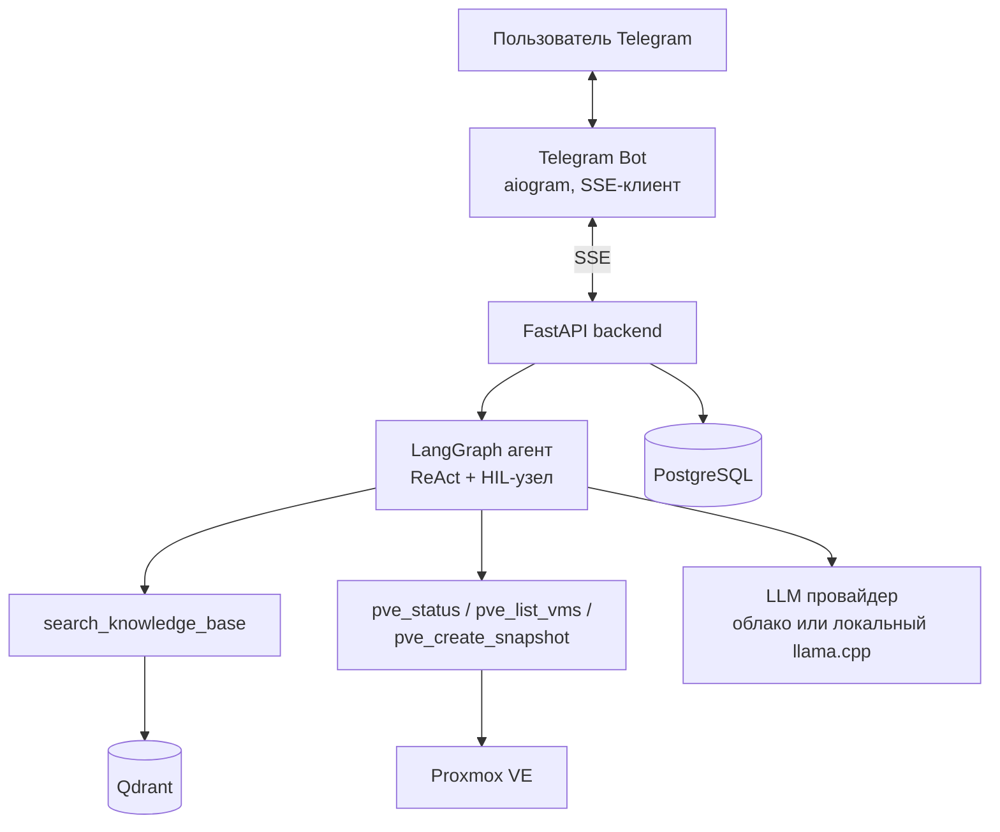

<!--
Презентация дипломного проекта.
Формат: Markdown-слайды (разделитель "---" = новый слайд), 12 слайдов.

КАК СКОНВЕРтИРОВАть В PDF/PPTX — см. docs/HOW_TO_BUILD_SLIDES.md
(рекомендуется Marp: точно 12 слайдов, таблицы/mermaid рендерятся как задумано;
pandoc работает без Node.js, но разбивает слайды с широкими таблицами на несколько).
-->

---
marp: true
theme: default
paginate: true
---

# Интеллектуальный ассистент мониторинга и диагностики ИТ-инфраструктуры

Дипломный проект курса **«ИИ-разработчик: от API до агентов»**, МТУСИ / Нетология

**Автор:** Осипов Дмитрий Владимирович

---

## Задача и пользователь

**Пользователь** — администратор on-premise ИТ-инфраструктуры (Proxmox / K8s / Linux-хосты).

**Проблема сегодня:** чтобы ответить на простой вопрос, администратор переключается
между источниками:
- документация / регламенты / runbook'и (grep по wiki/Confluence),
- консоль гипервизора или `kubectl` для статуса системы,
- разные интерфейсы для чтения и для действий.

**Сценарии, которые закрывает ассистент (один чат, один интерфейс — Telegram):**
1. Вопрос по документации → ответ с источниками (RAG).
2. Вопрос о текущем состоянии реальной системы → вызов инструмента к Proxmox VE.
3. Действие, меняющее состояние (снапшот VM) → выполняется только после
   подтверждения человеком.

---

## Почему здесь нужен ИИ

Обычный поиск по ключевым словам или FAQ-страница не справляются, потому что:

- **Вопрос администратора — контекстный**, не терминологический: не «что такое Pod»,
  а «почему эта VM недоступна» — нужно связать формулировку на естественном языке
  с нужным документом/действием, а не точным совпадением слов.
- **Один и тот же вопрос требует разных источников** — иногда ответ в документации,
  иногда это живые данные с реального кластера. Пользователь не должен сам решать,
  какой интерфейс использовать — это задача агента, а не человека.
- **Действие нужно не только показать, но и выполнить** — просто поиском по тексту
  невозможно создать снапшот VM. Нужен агент, который умеет вызывать инструменты
  и дожидаться подтверждения перед опасным действием.

**Альтернатива, от которой отказались:** статическая FAQ-страница/wiki-поиск —
отвергнута, потому что не решает ни контекстные вопросы, ни действия над
инфраструктурой.

---

## База знаний (RAG)

| Что выбрано | Из чего выбирали | Почему |
|---|---|---|
| Корпус: документация **Kubernetes**, 114 markdown-файлов (~1.5 MB) — архитектура, FAQ, безопасность | Готовый корпус из блока курса по RAG vs. сбор нового корпуса по Proxmox с нуля | Корпус уже собран и провалидирован в рамках курса; самостоятельный сбор документации под реальный Proxmox-стенд — отдельная трудоёмкая задача вне сроков диплома (см. слайд «Ограничения») |

**Почему RAG про Kubernetes, а инструменты агента — про Proxmox?**
Это два независимых слоя системы. Корпус собирался для RAG-блока курса независимо
от того, какой гипервизор станет первым подключённым инструментом агента. Агент сам
выбирает нужный слой под конкретный вопрос — для прототипа это осознанно, не
противоречие.

---

## Архитектура

**Путь запроса:** Telegram → FastAPI → LangGraph-граф → модель решает сама, нужен ли
инструмент → безопасные инструменты выполняются сразу, опасные — останавливаются на
`interrupt()` и ждут подтверждения → ответ стримится обратно через SSE токен за
токеном.

---

## Выбор модели

| Что выбрано | Из чего выбирали | Почему |
|---|---|---|
| **Локальная модель** `Qwen3.5-9B` (GGUF, квантование Q5_K_M) на собственном GPU-сервере, с возможностью переключения на облачные эндпоинты (OpenRouter/vseLLM) через единый каталог моделей | Облачный API (OpenAI/OpenRouter) vs. локальный self-hosted inference | Полный контроль над латентностью, контекстом и приватностью данных без повторяющейся платы за токены — для диплома и дальнейшей практической эксплуатации на собственной инфраструктуре это важнее стоимости разработки своего инференс-стека |

**Железо:** NVIDIA Tesla V100 16 GB на отдельном физическом сервере с СЖО.
- *Из чего выбирали:* современные консьюмерские GPU (RTX 3090/4090 — дороже, требуют
  мощного БП под бытовой формат) и б/у enterprise-ускорители (Tesla/A100 на вторичном рынке).
- *Почему выбрали:* готовая серверная платформа с системой жидкостного охлаждения,
  изначально спроектированная на несколько GPU — выгодно взять дешёвую карту на
  вторичном рынке, а не арендовать вычисления.
- *Ограничения:* 16 GB VRAM, архитектура Volta без FP8 — но с 4–8-битным
  квантованием достаточно для модели класса 9B с большим контекстом.
- **Инфраструктурная находка:** один `llama.cpp`-сервер на одной GPU проксирует и
  переключает несколько моделей (LLM, embeddings, reranker) под одним эндпоинтом —
  не нужно держать отдельный процесс на каждую модель.

---

## Хранение и поиск

| Параметр | Значение | Почему такое |
|---|---|---|
| Векторная БД | **Qdrant** | Открытый, легко разворачивается в Docker, хорошая интеграция с LlamaIndex |
| Фреймворк индексации/ретривера | **LlamaIndex** | ~80–100 строк кода на ingestion+query против ~220–280 у собственной bare-metal реализации; из коробки — chunking, reranking, source citing. Bare-metal вариант (`app/services/rag/rag_baremetal.py`) оставлен как учебный/отладочный слой |
| Размер чанка | **512 токенов**, overlap 64 | Экспериментально протестированы 3 стратегии чанкинга (fixed / recursive / semantic) и 5 комбинаций размер×overlap×top-k на 22 вопросах — `fixed_size` с chunk=512/overlap=64 показал лучший `Hit@5 = 0.727` |
| Reranker | `bge-reranker-v2-m3`, включён | Поднял `MRR@10` с 0.577 до 0.601 и `Recall@10` с 0.553 до 0.576 на той же выборке, без потери `Hit@5` |

Полный отчёт экспериментов — [`docs/chunking_report.md`](../docs/chunking_report.md).

---

## Агентный слой

**Один агент**, не мультиагентная система с координатором — осознанный выбор.

| Что выбрано | Из чего выбирали | Почему |
|---|---|---|
| Один LangGraph ReAct-агент с общим набором инструментов | Один агент vs. несколько специализированных агентов с координатором (RAG-агент + Proxmox-агент + router) | Задач и инструментов пока немного (4 инструмента) — координатор добавил бы сложность графа без выигрыша в качестве. Мультиагентный паттерн имеет смысл при росте числа доменов (добавление K8s/Linux-адаптеров) — заложено как путь развития |

**Инструменты (`app/agents/tools.py`, `app/agents/tools_proxmox.py`):**

| Инструмент | Тип | Назначение |
|---|---|---|
| `search_knowledge_base` | read-only | RAG-поиск по базе знаний, ответ + источники |
| `pve_status` | read-only | Статус узла Proxmox VE |
| `pve_list_vms` | read-only | Список VM/LXC с состоянием |
| `pve_create_snapshot` | **опасное, с HIL** | Снапшот тестовой VM — только после подтверждения кнопкой в Telegram |

HIL реализован через `langgraph.types.interrupt()`: граф останавливается перед
реальным сайд-эффектом, состояние сохраняется в PostgreSQL-чекпоинтере, выполнение
продолжается после решения пользователя — тем же треком, даже после перезапуска
сервиса.

---

## Поведение при сбоях

| Сбой | Что происходит |
|---|---|
| LLM-эндпоинт недоступен/таймаут | Одна автоматическая повторная попытка (`agent_persistent.py::call_model`), затем честное сообщение пользователю: «сервис модели временно недоступен, попробуйте через минуту» — диалог и история сохранены |
| RAG-сервис/Qdrant не инициализирован при старте | `/rag/query` и соответствующий инструмент агента возвращают явную ошибку вместо падения всего процесса |
| Перезапуск backend-сервиса | Диалог не теряется — история чата и состояние LangGraph-чекпоинтера хранятся в PostgreSQL, а не в памяти процесса |
| Вопрос вне базы знаний и вне инструментов | Модель отвечает, что не может помочь, вместо того чтобы выдумывать ответ (проверено сценарием «какая погода в Москве») |

**Что осознанно не реализовано:** многоуровневый circuit breaker с переключением
между несколькими LLM-провайдерами (облако → облако → локальная модель) — для
прототипа достаточно одной модели + одной повторной попытки; многоуровневый fallback
обозначен в «Куда развивать».

---

## Результат — как проверялось качество

**Retrieval-качество** (`tests/eval/rag/`, 114 документов, 22 вопроса golden-датасета):

| Эксперимент | Hit@5 | MRR@10 | Recall@10 |
|---|---:|---:|---:|
| Лучшая стратегия чанкинга (fixed_size, 512/64) | **0.727** | 0.577 | 0.553 |
| С включённым reranker (`bge-reranker-v2-m3`) | 0.727 | **0.601** | **0.576** |

**Ручная проверка end-to-end ответов** (5 вопросов по Kubernetes + 1 вопрос вне
домена): релевантные ответы получили `top_score` в диапазоне **0.57–0.74**; на
вопросе вне домена («Почему огурцы не красные?») сработал fallback при `top_score
= 0.221` — система не стала генерировать ответ по нерелевантному контексту.

**Функциональная проверка агента:** все 4 инструмента протестированы на реальном
Proxmox-кластере автора (не на моках) — статус узла, список VM, HIL-сценарий
снапшота с подтверждением через Telegram.

---

## Ограничения и планы

**Где система ошибается/отказывается отвечать:**
- Из трёх заявленных адаптеров инфраструктуры подключён только **Proxmox VE** — это
  прототип для одного типа инфраструктуры, не универсальный мониторинг.
- Proxmox-стенд — один узел (single-node datacenter), не кластер — `pve_status` не
  показывает кворум/HA-данные настоящего кластера.
- Набор инструментов умышленно небольшой (3 read-only + 1 опасное с HIL) — чтобы
  показать паттерн, а не закрыть весь спектр операций администратора.
- Модерация входящих сообщений и rate-limit реализованы как отдельные сервисы, но не
  подключены к продовому маршруту приёма сообщений.

**Куда развивать:**
- Kubernetes-адаптер (`k8s_get_pods`, `k8s_restart_deployment` через HIL) — база
  знаний уже готова.
- Linux-хосты — метрики/логи по SSH или node_exporter.
- Многоузловой Proxmox-кластер — `pve_status` готов показать кворум без правок кода.
- Расширение опасных действий с подтверждением — HIL-паттерн уже отработан и
  переносится на новые инструменты без изменения графа.

---

## Как это запустить / проверить

- Прототип развёрнут на **собственном домашнем Proxmox-кластере автора** —
  работающая ссылка на Telegram-бота передана в сопроводительном письме к сдаче.
- 3–5 примеров вопросов по предметной области и HIL-сценарий — в
  [`README.md`, раздел «Сценарии для проверяющего»](../README.md#сценарии-для-проверяющего).
- Код, документация, `.env.example`, тесты — в этом репозитории.

**Спасибо за внимание. Вопросы?**
