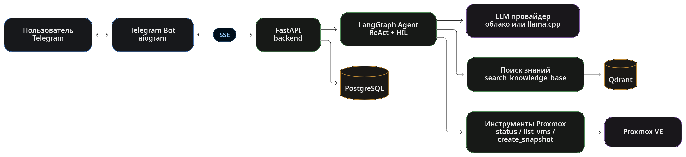

# Дипломный проект курса

## **«ИИ-разработчик: от API до агентов»**, МТУСИ / Нетология

## Тема проекта:
#### Интеллектуальный ассистент - сервис мониторинга и диагностики ИТ-инфраструктуры
 

## Автор:
#### Осипов Дмитрий Владимирович

---

## Задача и пользователь

**Пользователь сервиса** 

Системный администратор on-premise ИТ-инфраструктуры, которому необходимо получать сведения о состоянии системы и быстро находить информацию в технической документации.

**Проблема**  

Для решения повседневных задач администратору приходится обращаться к разным инструментам: искать информацию в документации и регламентах, проверять состояние инфраструктуры через консоль гипервизора и отдельно выполнять административные операции.

**Решение**

В прототип интеллектуального ассистент на примере интерфейса чата Telegram заложено несколько сценариев работы:
- Ответы на вопросы по базе знаний с указанием источников.
- Диагностика состояния информационной инфраструктуры через агентские инструменты.
- Возможность производить безопасные действий как самостоятельно так и по требованию оператора

---

## Почему здесь нужен ИИ

Традиционные алгоритмы ограничены заранее заданными правилами и сценариями. Администратор же формулирует задачи по-разному, часто описывая симптомы, а не называя конкретную операцию. Работа модели дает нам ряд преимуществ:

- **Понимание разных формулировок**
LLM интерпретирует запросы на естественном языке и помогает находить нужную информацию, даже если пользователь использует другие слова или описывает проблему косвенно.

- **Выбор способа решения**
В зависимости от контекста, агент определяет, что требуется: найти ответ в документации или получить актуальные данные используя инструменты.

- **Переход от ответа к действию**
В отличие от обычного поиска, агент может вызывать инструменты инфраструктуры. Потенциально опасные операции выполняются только после подтверждения оператора.

**Поэтому выбранный подход:** LLM + RAG + агент с инструментами и контролем.

---

## База знаний (RAG)

| Что выбрано | Альтернативы | Почему |
|---|---|---|
| **Корпус:** документация Kubernetes, 114 Markdown-файлов (~1,5 МБ) | Самостоятельно собрать документацию по другой предметной области | Готовый корпус уже подготовлен и проверен в рамках курса. Сбор отдельного корпуса другой области знаний, увеличил бы объём работ в рамках диплома |
| **Назначение:** поиск релевантных фрагментов и ответы с указанием источников | Поиск только по ключевым словам или статическая FAQ | RAG позволяет находить контекстные фрагменты документации и использовать их при формировании ответа |
| **Масштаб:** небольшой корпус для проверки работоспособности RAG | Расширенная база знаний и оптимизация под высокую нагрузку | На этапе прототипа приоритет — проверить полный цикл поиска и формирования ответа, а не масштабировать инфраструктуру раньше времени |

В дальнейшем корпус должен дополнятся информацией по Proxmox VE, Linux и др. предметными материалами.

---

## Архитектура

**Путь запроса:** Telegram → FastAPI → LangGraph-граф
модель решает сама, нужен ли инструмент → безопасные инструменты выполняются сразу, опасные — останавливаются на `interrupt()` и ждут подтверждения → ответ стримится обратно через SSE токен за токеном.

---

## Выбор модели

| Что выбрано | Альтернативы | Обоснование |
|---|---|---|
| **Локальная LLM:** Qwen3.5-9B, GGUF, Q5_K_M | Облачные API; локальные модели другого размера | Запуск на собственной инфраструктуре даёт контроль над обработкой данных и позволяет не платить за каждый токен облачному провайдеру |
| **Единый интерфейс подключения моделей** | Отдельная интеграция каждого провайдера в приложение | Позволяет переключаться между локальным инференсом и облачными API без существенной переработки прикладной логики |
| **Инференс через llama.cpp** | Более тяжёлые серверные стеки инференса | Подходит для запуска GGUF-моделей на доступном GPU и предоставляет API для интеграции с backend |

**Вывод:** Локальная модель выбрана как основной вариант для работы на собственном оборудовании, облачные API предусмотрены как альтернатива.

---
## Аппаратная платформа

**Выбранное оборудование:** NVIDIA Tesla V100 16 GB на физическом сервере с жидкостным охлаждением.

| Критерий | Обоснование |
|---|---|
| **Доступность оборудования** | Используется имеющаяся серверная платформа с поддержкой GPU. |
| **Видеопамять** | 16 GB VRAM позволяют запускать квантованную модель класса 9B при подходящих настройках. Около 9 GB занимает модель; остальная память доступна для контекста и служебных нужд инференса. |
| **Оперативная память** | RAM физического сервера — 125 GB; VM для GPU — 35 GB; VM сервисов — 8 GB. |
| **Экономика** | Стоимость Tesla V100 — около 15 000 ₽. Собственное оборудование позволяет избежать постоянной аренды GPU, но требует учитывать энергопотребление, обслуживание и амортизацию. |
| **Ограничения** | Объём VRAM ограничивает выбор модели, длину контекста и возможности параллельной обработки запросов. |

**Вывод:** локальный запуск требует настройки и обслуживания оборудования, но снижает зависимость от облачных провайдеров и оплаты каждого обращения к модели. По личной оценке, вложение в V100 за время обучения и разработки проекта оказалось оправданным: помимо практического результата, работа с GPU дала мне ценный опыт развёртывания и использования локальных моделей.

---

## Хранение и поиск

| Компонент | Выбор | Обоснование |
|---|---|---|
| **Векторная БД** | Qdrant | Специализированное хранилище для векторного поиска; удобный интерфейс; поддерживает поиск по сходству и фильтрацию по метаданным. Есть интеграция с LlamaIndex и удобное развёртывание в Docker. PostgreSQL остаётся для прикладных данных. |
| **Индексация и поиск** | LlamaIndex | Готовые компоненты для разбиения документов, retrieval и работы с источниками. Собственная реализация сохранена для отладки и сравнения |
| **Стратегия чанкинга** | Fixed-size: 512 токенов, overlap 64 | Лучшая из 3 протестированных стратегий по Hit@5 на выборке из 22 вопросов: **0,727** |
| **Переранжирование** | `bge-reranker-v2-m3` | На той же выборке MRR@10 вырос с **0,577 до 0,601**, Recall@10 — с **0,553 до 0,576**. Hit@5 не снизился |

**Метод проверки:** 3 стратегии чанкинга и 5 комбинаций параметров; для оценки reranker сравнивались результаты поиска до и после его применения.

[Подробности экспериментов: docs/chunking_report.md](https://github.com/DimOsSpb/AI-Dev-Diploma/blob/main/docs/chunking_report.md)

---

## Агентный слой

### Архитектурный выбор

**Один LangGraph ReAct-агент с общим набором инструментов**

- **Альтернатива**: несколько специализированных агентов с координатором.
- **Причина выбора**: всего 4 инструмента и два основных направления — поиск по документации и работа с Proxmox VE.
- **Преимущество**: проще граф выполнения и меньше архитектурной сложности на текущем этапе.
- **Развитие**: при добавлении Kubernetes и Linux можно перейти к специализированным агентам.

### Инструменты агента

| Инструмент | Назначение | Тип |
|---|---|---|
| `search_knowledge_base` | Поиск по документации с указанием источников | Read-only |
| `pve_status` | Получение статуса узла Proxmox VE | Read-only |
| `pve_list_vms` | Список VM/LXC и их состояний | Read-only |
| `pve_create_snapshot` | Создание снапшота тестовой VM | Требует подтверждения |

**Принцип работы:** агент выбирает инструмент в зависимости от запроса пользователя, а не использует один фиксированный сценарий для всех задач.

---
### Опасные операции — только с подтверждением пользователя

Для создания снапшота реализован механизм Human-in-the-Loop (HIL).

1. **Запрос:** агент определяет, что требуется создать снапшот.
2. **Пауза:** `langgraph.types.interrupt()` останавливает граф перед выполнением операции.
3. **Сохранение:** состояние графа записывается в PostgreSQL-чекпоинтер.
4. **Подтверждение:** пользователь принимает решение через Telegram.
5. **Продолжение:** граф возобновляет выполнение того же сценария.

### Почему это важно

- Сайд-эффект не выполняется до решения пользователя.
- Подтверждение встроено в сценарий агента, а не оставлено на уровне устной договорённости.
- Сохранённое состояние позволяет организовать возобновление после перезапуска сервиса.

**Компромисс:** добавляется шаг взаимодействия с пользователем, но снижается риск непреднамеренного выполнения опасной операции.

---

## Поведение при сбоях

### Как система обрабатывает ошибки

| Ситуация | Поведение системы |
|---|---|
| **LLM недоступна или истёк таймаут** | Одна повторная попытка, затем понятное сообщение пользователю. История диалога сохраняется. |
| **Qdrant / RAG не инициализирован** | API и инструмент агента возвращают явную ошибку вместо аварийного завершения процесса. |
| **Перезапуск backend** | История чата и состояние LangGraph сохраняются в PostgreSQL, а не только в памяти процесса. |
| **Вопрос вне доступных знаний и инструментов** | Ассистент может сообщить, что не располагает данными для ответа, вместо неподтверждённых утверждений. |

### Осознанное ограничение

**Автоматическое переключение между LLM-провайдерами не реализовано.**

Для прототипа выбрана более простая стратегия: одна повторная попытка и понятная ошибка. Переключение между облачными и локальной моделями — направление дальнейшего развития.

---

## Результат — как проверялось качество

### Количественная оценка retrieval

**Тестовый набор:** 114 документов, 22 вопроса golden-датасета.

| Конфигурация | Hit@5 | MRR@10 | Recall@10 |
|---|---:|---:|---:|
| Fixed-size chunking, 512/64 | **0,727** | 0,577 | 0,553 |
| С reranker `bge-reranker-v2-m3` | **0,727** | **0,601** | **0,576** |

- Среди проверенных вариантов чанкинга лучший результат показал `fixed_size` с размером чанка 512 токенов и overlap 64.
- Reranker повысил MRR@10 с 0,577 до 0,601, а Recall@10 — с 0,553 до 0,576.
- Hit@5 не изменился: 0,727.

**Вывод:** reranker улучшил ранжирование и полноту поиска в рамках тестового набора, не изменив Hit@5.

---

### Ручная проверка end-to-end сценариев

- **5 вопросов по Kubernetes:** релевантные ответы получили `top_score` в диапазоне 0,57–0,74.
- **Вопрос вне домена:** «Почему огурцы не красные?» — `top_score = 0,221`; сработал fallback, ответ по нерелевантному контексту не генерировался.

### Функциональная проверка агента

Все 4 инструмента проверены на реальном Proxmox-кластере, не на моках:

- получение статуса узла;
- получение списка VM/LXC;
- поиск по базе знаний;
- создание снапшота с подтверждением через Telegram (HIL).

**Вывод:** проверены ключевые сценарии RAG и интеграции с Proxmox VE. Результаты относятся к ограниченному набору тестов и не заменяют масштабную оценку качества.

---
## Ограничения и планы

### Текущие ограничения

- **Покрытие инфраструктуры:** из трёх запланированных адаптеров реализован только Proxmox VE.
- **Масштаб стенда:** один узел Proxmox VE; K8S требует дополнительных ресурсрв и времени на разработку.
- **Набор операций:** 3 read-only-инструмента и 1 операция с подтверждением через HIL.
- **Защитные механизмы:** модерация сообщений и rate-limit реализованы как отдельные сервисы, но в прототипе не включены в основной маршрут обработки запросов.

### Дальнейшее развитие

1. **Kubernetes:** адаптер для получения информации о подах и перезапуска Deployment с подтверждением через HIL.
2. **Linux-хосты:** сбор метрик и логов через SSH или node_exporter.
3. **Безопасность и управление:** подключение модерации и rate-limit к основному потоку, расширение набора контролируемых операций.

**Основа для расширения уже есть:** агентный подход и HIL позволяют добавлять новые инструменты, сохраняя общий принцип контроля действий.

---

### Как проверить прототип

- **Доступ:** Telegram-бот развёрнут на домашней инфраструктуре Proxmox VE; ссылка предоставлена в форме сдачи дипломного проекта.
- **Сценарии проверки:** примеры вопросов по документации и сценарий создания снапшота с подтверждением через Telegram описаны в `README.md`, в разделе «Сценарии для проверяющего».
- **Исходный код:** репозиторий содержит реализацию, документацию, `.env.example` и тесты.

### Итоги обучения

**Спасибо за этот учебный процесс!**

За время работы над проектом я получил новые навыки и практический опыт разработки ИИ-приложения.

Главный результат для меня — интерес к ИИ перестал быть туманным и превратился в желание глубже изучать небольшие прикладные модели, их обучение и применение в реальных системах, устройствах и производственных сценариях.

**Это не финал, а следующий этап моего пути в изучении ИИ.**
